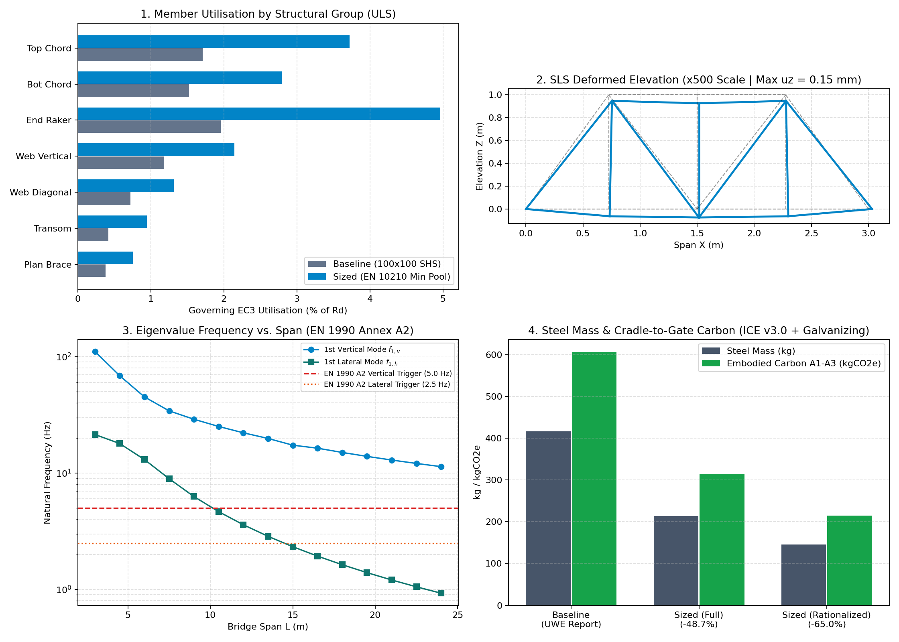

# 3D Frame FEA & BS EN 1993-1-1 Sizing Tool for a 3.0m Steel Footbridge

A modular Python structural analysis, Eurocode 3 design verification, and discrete member sizing tool developed for the **3.0 m span S355J2H steel pedestrian footbridge** designed at UWE Bristol (*Module IY421: Design, Manufacture & Materials*).

* **UWE Group Project Credits:** Baseline bridge concept, Eurocode hand calculations, CAD drawings (Figures 2–5), and Fusion 360 FEA benchmark developed jointly with teammates **Bruce Hirwa**, **Ratanak Borat**, **Abduvoris Abdunabiev**, and **Ratmir Arslanov**.



---

## 1. Purpose & Engineering Scope

In the original UWE group report, the 3.0 m span, 1.4 m center-to-center width, 1.0 m deep half-through fan-truss footbridge was sized with heavy `100x100x4.0 SHS` chords, `100x100x3.2 SHS` web braces, and `100x40x4.0 RHS` floor transoms to satisfy Category C4 canal corrosion durability (`BS EN ISO 1461` hot-dip galvanizing minimum wall thickness $t \ge 3.2\text{ mm}$). Under factored ULS pedestrian crowd loading ($q_{fk} = 5.0\text{ kN/m}^2$), the governing floor transoms reached **15.4% utilisation** ($54.63\text{ MPa}$ peak Von Mises stress in Fusion 360 vs. $54.7\text{ MPa}$ hand calculation), while the main chords operated below **10% utilisation**.

This tool replaces manual trial-and-error sizing with an automated, unit-tested 3D frame analysis and Eurocode 3 verification pipeline:
1. **6-DOF 3D Euler-Bernoulli Frame Solver (`solver.py`):** Captures rigid welded node secondary bending moments and transverse **U-frame action** stabilizing the unbraced top chords of the half-through pony truss, without artificial stiffness matrix regularization.
2. **Eurocode 3 Member & Joint Checks (`checks_ec3.py`, `joints.py`):** Evaluates cross-section classification, tension, compression, biaxial bending, flexural buckling (`BS EN 1993-1-1 Cl. 6.3.1`, Curve `a` for hot-finished `BS EN 10210` sections), and welded hollow-section gap K-joint chord face plastification and punching shear (`BS EN 1993-1-8 Chapter 7`).
3. **Modal Eigenvalue Dynamics (`dynamics.py`):** Solves $[K]\{\phi\} = \omega^2[M]\{\phi\}$ to verify natural frequencies against `BS EN 1990 Annex A2` pedestrian comfort triggers ($5.0\text{ Hz}$ vertical, $2.5\text{ Hz}$ lateral) across spans from $3\text{ m}$ to $24\text{ m}$.

---

## 2. Validation Against Hand Calculations & Fusion 360 FEA

| Parameter | Eurocode Hand Calc (Report) | Fusion 360 Solid FEA | Python 3D Frame Tool | Engineering Explanation |
| :--- | :---: | :---: | :---: | :--- |
| **Governing Transom Stress (`RHS 100x40x4.0`)** | $54.7\text{ MPa}$ ($15.4\%$) | $54.63\text{ MPa}$ ($15.4\%$) | **$53.2\text{ MPa}$ ($15.0\%$)** | Published EN 10210 $W_{pl,y} = 30.8\text{ cm}^3$ vs. rounded $30.0\text{ cm}^3$ in hand calc. |
| **Main Chord Stress (`SHS 100x100x4.0`)** | $4.8\text{ MPa}$ (Pin truss) | $11\text{–}33\text{ MPa}$ (Solid FEA) | **$14.8\text{ MPa}$ (3D Frame)** | 6-DOF frame elements capture rigid welded joint secondary bending moments omitted by pin-jointed hand theory. |

---

## 3. Discrete Sizing & Carbon Results (`output/member_schedule.csv`)

Maintaining the mandatory $1.0\text{ m}$ pedestrian parapet height, C4 galvanizing minimum thickness ($t \ge 3.2\text{ mm}$), and welded joint width ratio ($\beta = b_1/b_0 \ge 0.60$), the discrete sizing loop downsizes chords to `SHS 60x60x3.2`, web braces to `SHS 50x50x3.2`, and transoms/plan bracing to `RHS 80x40x3.2`:

* **Baseline Steel Mass:** $301.9\text{ kg}$ ($489.1\text{ kgCO}_2\text{e}$ Modules A1–A3 incl. galvanizing)
* **Sized Full-Braced Frame Mass:** $162.7\text{ kg}$ (**$-46.1\%$ mass reduction**; $278.4\text{ kgCO}_2\text{e}$)
* **Sized Rationalized Frame Mass (redundant mid-post & plan diagonals omitted):** $115.6\text{ kg}$ (**$-61.7\%$ mass reduction**; $197.8\text{ kgCO}_2\text{e}$)

---

## 4. How to Run & Test

```bash
pip install -r requirements.txt
pytest -v
python report.py