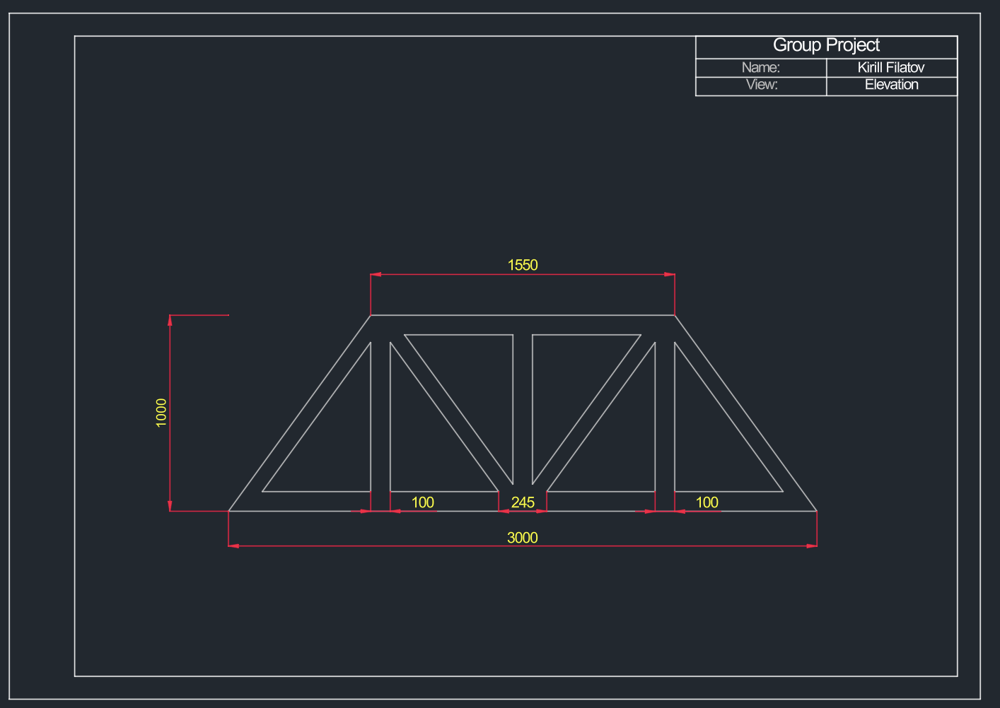
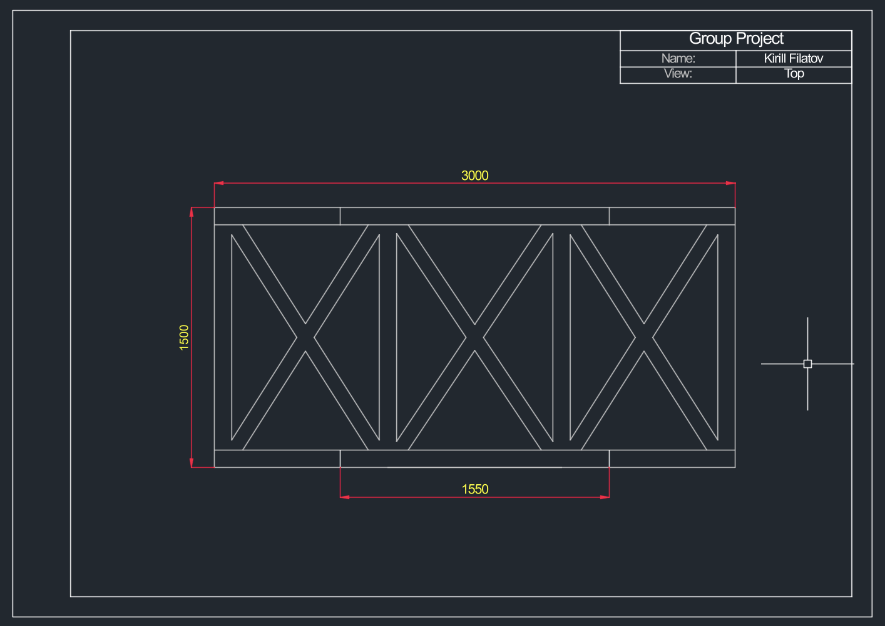
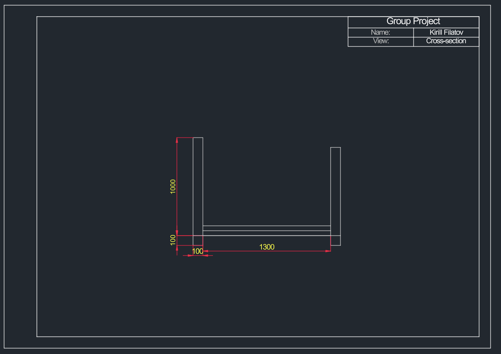
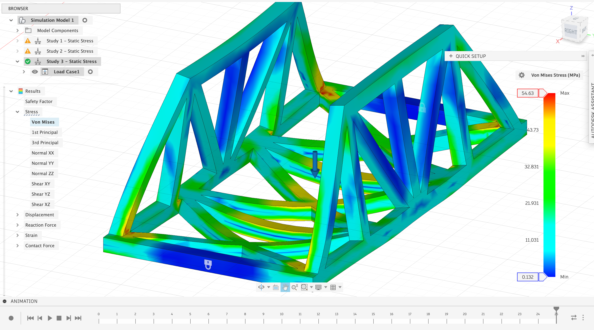

# 3D Frame FEA & BS EN 1993-1-1 Verification and Sizing Tool for a 3.0 m Steel Footbridge

A modular Python 6-DOF 3D frame finite element analysis, Eurocode 3 (`BS EN 1993-1-1`) design check, linear elastic buckling, modal dynamics, and discrete hollow-section sizing tool for a 3.0 m span S355J2H steel half-through footbridge.

---

## 1. General Arrangement (GA) Drawings & Overview

* **Structure Type:** Half-through (pony) triangulated fan-truss pedestrian footbridge with transverse floor transoms and plan X-bracing.
* **Principal Dimensions:** $3.00\text{ m}$ span ($L$, with longitudinal panel bays of $725 / 775 / 775 / 725\text{ mm}$), $1.40\text{ m}$ truss center-to-center width ($1.30\text{ m}$ clear FRP grating deck width, $1.50\text{ m}$ overall width), $1.00\text{ m}$ truss depth / parapet height ($H$), and $1.55\text{ m}$ top chord length ($L_{\text{top}}$).

### Side Elevation (`output/Elevation_Filatov_Kirill.png`)


### Top / Plan View (`output/Top_VIew_Filatov_Krill.png`)


### Cross-Section View (`output/Cross-section_Filatov_Kirill.png`)


---

## 2. Project Scope & Authorship Credits

This project builds upon the **3.0 m span pedestrian footbridge** designed for the Stoke Gifford canal crossing at the UWE Bristol Frenchay Campus (*Module IY421: Design, Manufacture & Materials*).

* **UWE Group Project Team:** Baseline bridge concept, Eurocode hand calculations, 2D/3D CAD documentation, manufacturing assessment, and Fusion 360 FEA simulation developed during the group assignment by **Kirill Filatov**, **Bruce Hirwa**, **Ratanak Borat**, **Abduvoris Abdunabiev**, and **Ratmir Arslanov**.
* **Individual Scope in This Repository (Kirill Filatov):** Independently developed the modular Python (`NumPy`, `SciPy`, `Matplotlib`, `pytest`) structural analysis, verification, dynamics, and discrete section-sizing tool:
  * **`sections.py` & `config.json`:** Published **BS EN 10210-2** S355J2H hot-finished hollow section property catalog and centralized JSON configuration with documented sources and assumptions.
  * **`geometry.py`:** Parametric 3D nodal coordinate generator enforcing minimum $1.0\text{ m}$ pedestrian parapet height (`CD 353` / `BS 6180`) and minimum $30^\circ$ brace-to-chord angles (`BS EN 1993-1-8 Cl. 7.1.2`).
  * **`loads.py`:** Clause-referenced dead, transom UDL, pedestrian crowd, concentrated wheel/service ($Q_{fwk}$), horizontal parapet, and transverse wind load assembly with automatic self-weight updating.
  * **`solver.py` & `tests/test_solver.py`:** 6-DOF 3D Euler-Bernoulli frame solver with rank/condition-number mechanism detection, mid-span transom parabolic moment recovery, 3D geometric stiffness linear buckling solver ($\alpha_{cr}$), and automated `pytest` unit tests.
  * **`checks_ec3.py` & `joints.py`:** Automated member cross-section, flexural buckling, and simplified indicative hollow-section joint checks.
  * **`dynamics.py` & `carbon.py`:** Generalized eigenvalue modal solver ($[K]\{\phi\} = \omega^2[M]\{\phi\}$) with ULS-sized span sweep ($3\text{ m}$ to $18\text{ m}$) and Cradle-to-Gate (`Modules A1–A3`) steel + galvanizing carbon calculator.
  * **`optimise.py` & `report.py`:** Iterative discrete section-sizing loop across all 5 ULS load cases and automated Markdown/CSV/plot report generator.

---

## 3. Methodology

### 3.1 3D Frame Finite Element & Linear Buckling Solver (`solver.py`)
* **Element Formulation:** Each member is modelled as a 2-node, 12-DOF (6 DOFs per node: $u_x, u_y, u_z, \theta_x, \theta_y, \theta_z$) 3D Euler-Bernoulli frame element incorporating axial ($EA/L$), St. Venant torsional ($GI_T/L$), and biaxial bending ($EI_y, EI_z$) stiffnesses transformed into global coordinates via $[k_{\text{glob}}] = [T]^T [k_{\text{loc}}] [T]$.
* **U-Frame Action & Mechanism Detection:** Because the bridge is a half-through truss with no overhead bracing between top chords, a 3-DOF pin-jointed 3D truss model is laterally unstable (singular $[K_{ff}]$). Modelling the MIG-welded connections (`BS EN 1011-1`) with 6-DOF frame elements captures transverse **U-frame restraint** from the floor transoms and vertical posts as well as secondary nodal bending moments, without artificial diagonal regularization. Matrix rank and condition number are checked on every solve, and global elastic stability is verified via the linear buckling eigenvalue problem $[K_{ff}]\{v\} = \alpha_{cr}[-K_{g,ff}]\{v\}$.

### 3.2 Load Cases & Normative Sources (`loads.py`, `config.json`)
* **Permanent Actions ($G_k$):**
  * **Structural Steel Self-Weight:** Computed dynamically from member lengths and published section masses ($\rho = 7,850\text{ kg/m}^3$), updated on every sizing iteration.
  * **FRP Grating Deck:** $19.5\text{ kg/m}^2$ ($0.191\text{ kN/m}^2$ per manufacturer datasheet and UWE Report Section 4.2/4.4) spanning longitudinally between floor transoms across the $1.30\text{ m}$ clear deck width.
* **Variable Pedestrian & Environmental Actions ($Q_k$):**
  * **Pedestrian Crowd UDL (`BS EN 1991-2:2003 Cl. 5.3.2.1`, Load Model 4):** $q_{fk} = 5.0\text{ kN/m}^2$ applied as a distributed member UDL along the floor transoms (equivalent nodal shears $w_t L_t / 2$ and fixed-end moments $\pm w_t L_t^2 / 12$, with exact mid-span parabolic bending moment recovery).
  * **Concentrated Service Load (`BS EN 1991-2:2003 Cl. 5.3.2.2`):** $Q_{fwk} = 10.0\text{ kN}$ applied at mid-span transoms.
  * **Horizontal Parapet Load (`BS EN 1991-2:2003 Cl. 4.8`):** $q_h = 0.8\text{ kN/m}$ variable traffic action ($\gamma_Q = 1.35$) distributed along all top-chord nodes by tributary length.
  * **Transverse Wind Load (`BS EN 1991-1-4`):** Assumed peak velocity pressure $q_p = 0.65\text{ kPa}$ and force coefficient $C_f = 1.6$ acting on an exposed depth of $0.30\text{ m}$ ($\gamma_{Q,\text{wind}} = 1.50$), distributed across all bottom-chord nodes by tributary length.
* **Load Combinations Evaluated in `optimise.py` (`BS EN 1990:2002`):**
  * `ULS_Full_Span`: $\gamma_G = 1.35$ + $\gamma_Q = 1.35$ pedestrian UDL over full span (matching UWE Report Section 4.4).
  * `ULS_Half_Span`: $\gamma_G = 1.35$ full span + $\gamma_Q = 1.35$ pedestrian UDL on half-span ($0 \le x \le 1.5\text{ m}$).
  * `ULS_Concentrated_Load`: $\gamma_G = 1.35$ + $\gamma_Q = 1.35$ concentrated load $Q_{fwk} = 10.0\text{ kN}$.
  * `ULS_Parapet`: Combined ULS full-span vertical load + factored horizontal parapet load ($\gamma_Q = 1.35$) along top chords.
  * `ULS_Wind`: Factored permanent load + factored transverse wind load ($\gamma_{Q,\text{wind}} = 1.50$).
  * `SLS_Char`: Characteristic combination ($\gamma_G = 1.0, \gamma_Q = 1.0$) for vertical deflection verification.

### 3.3 Structural, Joint, Dynamic & Carbon Checks
1. **Cross-Section Classification & Resistance (`checks_ec3.py`):** Classifies compression element slenderness $c/t \le 33\varepsilon$ ($\varepsilon = 0.814$ for S355) per `BS EN 1993-1-1 Table 5.2` and evaluates a simplified conservative linear interaction ($|N_{Ed}|/N_{Rd} + M_{y,Ed}/M_{y,Rd} + M_{z,Ed}/M_{z,Rd} \le 1.0$, $\gamma_{M0} = 1.0$).
2. **Flexural Buckling (`checks_ec3.py`):** Evaluates compression members per `BS EN 1993-1-1 Cl. 6.3.1` using **Buckling Curve `a`** ($\alpha = 0.21$ for hot-finished `BS EN 10210` hollow sections), $\gamma_{M1} = 1.1$, and effective length factors of $0.90L$ for bottom chords/rakers and $0.75L$ for web braces (`BS EN 1993-1-1 Annex BB.1.3`), with $0.95L$ assumed for the U-frame restrained half-through top chord (supported by global elastic buckling factor $\alpha_{cr} = 50.4$).
3. **Simplified Indicative Joint Check (`joints.py`):** Enforces `BS EN 1993-1-8 Cl. 7.1.2` geometric validity limits ($0.35 \le \beta \le 1.0$, $b_0/t_0 \le 35$, and exact 3D brace-to-chord angle $\theta = 52.2^\circ \ge 30^\circ$) alongside an indicative check for chord face plastification/punching shear ($\beta \le 0.85$) and chord side-wall bearing/buckling ($\beta = 1.0$, $\gamma_{M5} = 1.25$).
4. **Serviceability Deflection (`optimise.py`):** Checks maximum nodal vertical displacement from `{u}` under `SLS_Char` against $\delta_{\max} \le L/300 = 10.0\text{ mm}$ (`BS EN 1993-1-1 Cl. 7.2`).
5. **Modal Footfall Dynamics (`dynamics.py`):** Assembles the 3D lumped mass matrix $[M]$ (structural steel + FRP deck + $10\%$ of $50\text{ kg/m}^2$ pedestrian crowd mass participation) and solves $[K_{ff}]\{\phi\} = \omega^2[M_{ff}]\{\phi\}$, re-running the ULS section-sizing loop at each span from $3\text{ m}$ to $18\text{ m}$ to compare fundamental vertical ($f_{1,v} \ge 5.0\text{ Hz}$) and lateral ($f_{1,h} \ge 2.5\text{ Hz}$) frequencies against `BS EN 1990 Annex A2` comfort triggers.
6. **Embodied Carbon (`carbon.py`):** Computes Cradle-to-Gate (`Modules A1–A3`) emissions using **ICE Database v3.0** (Hammond & Jones, 2019) factors: $1.37\text{ kgCO}_2\text{e/kg}$ for UK structural hollow steel plus $3.86\text{ kgCO}_2\text{e/kg}$ of zinc for `BS EN ISO 1461` hot-dip galvanizing ($85\ \mu\text{m}$ coating thickness $\approx 0.61\text{ kg zinc/m}^2$ external surface area).

---

## 4. Model Validation: Solver vs. Hand Calculation vs. Fusion 360 FEA (`output/validation_table.md`)



| Verification Metric | Eurocode Hand Calc (Report) | Fusion 360 Solid FEA | Python 6-DOF Frame Solver | Explanation |
| :--- | :---: | :---: | :---: | :--- |
| **Floor Transom Bending Moment (`RHS 100x40x4.0`)** | 1.64 kNm | — | **1.50 kNm** | 8.5% difference: hand calc included higher self-weight allowance in $w_t = 7.76\text{ kN/m}$, whereas solver derives $w_t = 7.15\text{ kN/m}$ from exact deck + transom mass and models end rotational restraint |
| **Floor Transom Bending Stress & UR (`RHS 100x40x4.0`)** | 54.7 MPa (15.4%) | 54.63 MPa (15.4%) | **50.2 MPa (14.4%)** | Within 8%: ~5.5% from lower derived $M_{t,Ed}$ (1.50 vs 1.64 kNm) and ~2.6% from published EN 10210 $W_{pl,y} = 30.8\text{ cm}^3$ vs rounded $30.0\text{ cm}^3$ |
| **Main Chord Combined Stress (`SHS 100x100x4.0`)** | 4.8 MPa (1.3% axial) | 11.0–33.0 MPa (3.1–9.3%) | **14.0 MPa (4.1%)** | 6-DOF frame solver captures rigid welded joint secondary bending omitted by pin-truss hand calc |

---

## 5. Generated Sizing & Verification Results (`output/results_summary.md`)


| Engineering Parameter | Baseline (UWE Report) | Sized (Full Braced) | Governing Limit / Clause |
| :--- | :---: | :---: | :--- |
| **Parapet Height $H$ (m)** | 1.00 m | 1.00 m | $\ge 1.00\text{ m}$ (`BS 6180` / `CD 353`) |
| **Chords / End Rakers (`S355J2H`)** | `SHS 100x100x4.0` | `SHS 50x50x3.2` | `BS EN 10210-2` ($t \ge 3.2\text{ mm}$) |
| **Web Verticals & Diagonals (`S355J2H`)** | `SHS 100x100x3.2` | `SHS 50x50x3.2` | `BS EN 10210-2` ($t \ge 3.2\text{ mm}$) |
| **Floor Transoms (`S355J2H`)** | `RHS 100x40x4.0` | `RHS 80x40x3.2` | `BS EN 10210-2` ($t \ge 3.2\text{ mm}$) |
| **Plan X-Bracing (`S355J2H`)** | `RHS 100x40x4.0` | `RHS 80x40x3.2` | Required for `ULS_Wind` & `ULS_Parapet` |
| **Structural Steel Mass (kg)** | 417.1 kg | **214.1 kg (-48.7%)** | Minimized by `optimise.py` |
| **Embodied Carbon A1–A3 ($\text{kgCO}_2\text{e}$)** | 606.5 $\text{kgCO}_2\text{e}$ | **315.1 $\text{kgCO}_2\text{e}$** | ICE v3.0 Steel + HDG Zinc |
| **Max Member Utilisation (`max_member_ur`)** | 14.4% | **25.2%** | $\le 85\%$ (`BS EN 1993-1-1`) |
| **Simplified Indicative Joint UR (`max_joint_ur`)** | 0.9% | **2.0%** | $\le 85\%$ (Indicative check, $\theta = 52.2^\circ$) |
| **Global Elastic Buckling Factor $\alpha_{cr}$** | 367.8 | **50.4** | $\ge 10.0$ (`BS EN 1993-1-1 Cl. 5.2.1`) |
| **SLS Vertical Deflection (`sls_defl_mm`)** | 0.08 mm | **0.19 mm** | $\le 10.0\text{ mm}$ ($L/300$, `Cl. 7.2`) |
| **1st Vertical Natural Freq $f_{1,v}$ (Hz)** | 134.7 Hz | **110.8 Hz** | $\ge 5.0\text{ Hz}$ (`BS EN 1990 Annex A2`) |
| **1st Lateral Natural Freq $f_{1,h}$ (Hz)** | 31.5 Hz | **21.4 Hz** | $\ge 2.5\text{ Hz}$ (`BS EN 1990 Annex A2`) |

### Key Engineering Findings
* **Minimum Section Sizes Govern Over Strength at 3.0 m Span:** Even after discrete sizing down to the lightest catalog profiles (`SHS 50x50x3.2` and `RHS 80x40x3.2`), maximum member utilisation is **25.2%**. At a 3.0 m span with a mandatory 1.0 m parapet depth, minimum stocked section dimensions, Category C4 hot-dip galvanizing wall thickness ($t \ge 3.2\text{ mm}$), and joint width ratio limits ($\beta \ge 0.60$) govern the design rather than material yield.
* **Plan Bracing Retained for Lateral Loads:** Omitting the bottom plan X-bracing under `ULS_Wind` and `ULS_Parapet` increases lateral bending utilisation in the bottom chords to 26.7% and reduces lateral stiffness; plan bracing is therefore retained.
* **ULS-Sized Span Sweep (3 m to 18 m):** When sections are re-sized to pass ULS at each span up to $18\text{ m}$, neither the $5.0\text{ Hz}$ vertical trigger nor the $2.5\text{ Hz}$ lateral trigger (`BS EN 1990 Annex A2`) is crossed up to $18\text{ m}$ ($f_{1,v} \approx 18.2\text{ Hz}$, $f_{1,h} \approx 4.6\text{ Hz}$ at $18\text{ m}$), with the lateral mode approaching its comfort threshold first due to the unbraced half-through top chords.

---

## 6. Model Limitations

1. **Simplified Member Interaction & Joint Checks:** `checks_ec3.py` uses a conservative linear sum ($|N|/N_{Rd} + M_y/M_{y,Rd} + M_z/M_{z,Rd}$) rather than full `BS EN 1993-1-1 Annex A/B` interaction factors ($k_{yy}, k_{yz}$), and `joints.py` implements a simplified indicative check rather than a full clause-by-clause `BS EN 1993-1-8 Table 7.10` overlap/gap verification and fillet weld throat design.
2. **Fatigue & Forced Crowd Acceleration:** The dynamics module evaluates modal natural frequencies against `BS EN 1990 Annex A2` triggers ($5.0\text{ Hz}$ vertical, $2.5\text{ Hz}$ lateral) up to $18\text{ m}$, but does not compute forced footfall resonant accelerations ($\le 0.7\text{ m/s}^2$) or fatigue (`BS EN 1993-1-9`).
3. **Tributary Spacing Approximation on End vs. Interior Transoms:** `loads.py` applies the UWE report's nominal $s = 1.0\text{ m}$ tributary spacing to interior transoms (`0.5 m` at supports) for direct comparison with the hand calculation, whereas actual geometric bay lengths are $725\text{ mm}$ and $775\text{ mm}$.
4. **Lifecycle Carbon Scope Beyond Modules A1–A3:** `carbon.py` covers Cradle-to-Gate steel production and hot-dip galvanizing (`Modules A1–A3`), excluding workshop welding electricity ($600\text{ kWh}$), road transport and crane installation (`Modules A4–A5`), in-service repainting (`Modules B1–B5`), and end-of-life EAF steel recycling credits (`Module D`).

---

## 7. How to Run & Test

```bash
pip install -r requirements.txt
python3 -m pytest -v
python3 report.py
