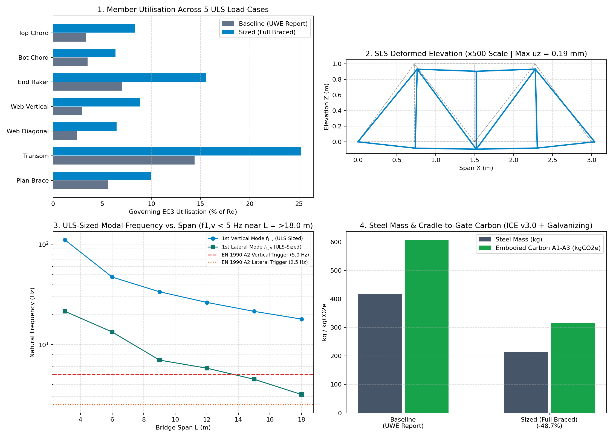

# 3D Frame FEA & BS EN 1993-1-1 Verification and Sizing Tool for a 3.0 m Steel Footbridge

A modular Python 6-DOF 3D frame finite element analysis, Eurocode 3 (`BS EN 1993-1-1` / `BS EN 1993-1-8`) design check, modal dynamics, and discrete hollow-section sizing tool for a 3.0 m span S355J2H steel half-through footbridge[cite: 5, 6, 7, 9, 11, 12].



---

## 1. General Arrangement (GA) Overview

* **Structure Type:** Half-through (pony) triangulated fan-truss pedestrian footbridge with transverse floor transoms and plan bracing[cite: 1, 8, 12].
* **Principal Dimensions:** $3.00\text{ m}$ span ($L$), $1.40\text{ m}$ truss center-to-center width ($1.30\text{ m}$ clear FRP grating deck width), $1.00\text{ m}$ truss depth / parapet height ($H$), and $1.55\text{ m}$ top chord length ($L_{\text{top}}$)[cite: 1, 6, 8].

---

## 2. Project Scope & Authorship Credits

This project builds upon the **3.0 m span pedestrian footbridge** designed for the Stoke Gifford canal crossing at the UWE Bristol Frenchay Campus (*Module IY421: Design, Manufacture & Materials*)[cite: 1, 6, 12].

### UWE Group Project Credits (Baseline Design & Report)
* **Kirill Filatov (Author):** 2D side-elevation General Arrangement AutoCAD drawing (Report Figure 2)[cite: 1] and individual development of this Python structural analysis, verification, dynamics, and sizing repository[cite: 3, 12].
* **Bruce Hirwa:** 2D plan-view AutoCAD drawing of the floor transoms and X-bracing layout (Report Figure 4) and report contributions[cite: 1, 3, 12].
* **Ratanak Borat:** 2D cross-section AutoCAD drawing (Report Figure 3) and report contributions[cite: 1, 12].
* **Abduvoris Abdunabiev:** 3D CAD bridge model (Report Figure 5) and report contributions[cite: 1, 12].
* **Ratmir Arslanov:** Baseline Eurocode hand calculations, Fusion 360 static stress FEA simulation (Report Figure 1), manufacturing cost assessment, and lifecycle environmental assessment[cite: 1, 12].

### Individual Scope Built in This Repository
Developed independently in Python (`NumPy`, `SciPy`, `Matplotlib`, `pytest`) as a standalone calculation, verification, and automated section-sizing tool[cite: 3, 7, 13]:
* **`sections.py` & `config.json`:** Published **BS EN 10210-2** S355J2H hot-finished hollow section property catalog and centralized JSON configuration[cite: 3, 6, 13].
* **`geometry.py`:** Parametric 3D nodal coordinate and topology generator enforcing minimum $1.0\text{ m}$ pedestrian parapet height (`CD 353` / `BS 6180`) and minimum $30^\circ$ brace-to-chord angles (`BS EN 1993-1-8 Cl. 7.1.2`)[cite: 8].
* **`loads.py`:** Clause-referenced dead, pedestrian crowd, concentrated, parapet, and wind load vector assembly with automatic self-weight updating[cite: 10].
* **`solver.py` & `tests/test_solver.py`:** 6-DOF 3D Euler-Bernoulli frame solver with rank/condition-number mechanism detection and unit tests[cite: 3, 12].
* **`checks_ec3.py` & `joints.py`:** Automated member cross-section, flexural buckling, and welded SHS gap K-joint checks[cite: 5, 9].
* **`dynamics.py` & `carbon.py`:** Generalized eigenvalue modal solver ($[K]\{\phi\} = \omega^2[M]\{\phi\}$) and Cradle-to-Gate (`Modules A1–A3`) steel + galvanizing carbon calculator[cite: 4, 7].
* **`optimise.py` & `report.py`:** Iterative discrete section-sizing engine and automated Markdown/CSV/plot report generator[cite: 11, 13].

---

## 3. Methodology

### 3.1 3D Frame Finite Element Solver (`solver.py`)
* **Element Formulation:** Each member is modelled as a 2-node, 12-DOF (6 DOFs per node: $u_x, u_y, u_z, \theta_x, \theta_y, \theta_z$) 3D Euler-Bernoulli frame element incorporating axial ($EA/L$), St. Venant torsional ($GI_T/L$), and biaxial bending ($EI_y, EI_z$) stiffnesses transformed into global coordinates via $[k_{\text{glob}}] = [T]^T [k_{\text{loc}}] [T]$[cite: 3, 12].
* **U-Frame Action & Mechanism Detection:** Because the bridge is a half-through truss with no overhead bracing between top chords, a 3-DOF pin-jointed 3D truss model is laterally unstable (singular $[K_{ff}]$)[cite: 3]. Modelling the MIG-welded connections (`BS EN 1011-1`) with 6-DOF frame elements captures transverse **U-frame restraint** from the floor transoms and vertical posts as well as secondary nodal bending moments, without artificial diagonal regularization[cite: 1, 3, 5, 12]. Matrix rank and condition number are checked on every solve to detect kinematic mechanisms[cite: 3].

### 3.2 Load Cases & Normative Sources (`loads.py`, `config.json`)
* **Permanent Actions ($G_k$):**
  * **Structural Steel Self-Weight:** Computed dynamically from member lengths and published section masses ($\rho = 7,850\text{ kg/m}^3$), updated on every sizing iteration[cite: 6, 10, 11].
  * **FRP Grating Deck:** $19.5\text{ kg/m}^2$ ($0.191\text{ kN/m}^2$) applied across the $1.30\text{ m}$ clear deck width[cite: 1, 6, 10].
* **Variable Pedestrian & Environmental Actions ($Q_k$):**
  * **Pedestrian Crowd UDL (`BS EN 1991-2:2003 Cl. 5.3.2.1`, Load Model 4):** $q_{fk} = 5.0\text{ kN/m}^2$ over the deck area plus $10\%$ crowd mass participation ($50\text{ kg/m}^2 \times 0.10$)[cite: 1, 6, 7, 10].
  * **Additional Implemented Actions (`loads.py`):** Concentrated wheel/service load $Q_{fwk} = 10.0\text{ kN}$ (`BS EN 1991-2 Cl. 5.3.2.2`), horizontal parapet load $0.8\text{ kN/m}$ (`BS EN 1991-2 Cl. 4.8`), and transverse wind action ($q_w = 0.65\text{ kPa}$, $C_f = 1.6$ per `BS EN 1991-1-4`)[cite: 6, 10].
* **Load Combinations (`BS EN 1990:2002` & UK NA):**
  * `ULS_Full_Span`: $\gamma_G = 1.35$ (permanent) and $\gamma_{Q,\text{traffic}} = 1.35$ (pedestrian live load over full $3.0\text{ m}$ span, matching UWE Report Section 4.4)[cite: 1, 6, 10, 11].
  * `ULS_Half_Span`: Factored dead load over full span + factored pedestrian live load on half-span ($0 \le x \le 1.5\text{ m}$) to capture asymmetric mid-span web shear[cite: 3, 10, 11].
  * `SLS_Char`: Characteristic combination ($\gamma_G = 1.0, \gamma_Q = 1.0$) for vertical deflection verification[cite: 10, 11].

### 3.3 Structural, Joint, Dynamic & Carbon Checks
1. **Cross-Section Classification & Resistance (`checks_ec3.py`):** Classifies compression element slenderness $c/t \le 33\varepsilon$ ($\varepsilon = \sqrt{235/f_y} = 0.814$ for S355) per `BS EN 1993-1-1 Table 5.2` and checks axial, biaxial bending, and shear interaction ($\gamma_{M0} = 1.0$, `Cl. 6.2`)[cite: 5, 6].
2. **Flexural Buckling (`checks_ec3.py`):** Evaluates compression members per `BS EN 1993-1-1 Cl. 6.3.1` using **Buckling Curve `a`** ($\alpha = 0.21$ for hot-finished `BS EN 10210` hollow sections), $\gamma_{M1} = 1.1$, and system effective lengths from `Annex BB.1.3` ($0.90L$ bottom chords/rakers, $0.95L$ U-frame top chord, $0.75L$ web braces)[cite: 5, 6].
3. **Welded Hollow-Section Joints (`joints.py`):** Verifies gap K-joints against **chord face plastification** and **chord punching shear** per `BS EN 1993-1-8:2005 Chapter 7 (Table 7.2)` with $\gamma_{M5} = 1.25$, enforcing $0.35 \le \beta \le 1.0$ (and $\beta = b_1/b_0 \ge 0.60$ in the sizing loop), $b_0/t_0 \le 35$, and $\theta \ge 30^\circ$[cite: 6, 8, 9, 11].
4. **Serviceability Deflection (`optimise.py`):** Checks nodal vertical displacement from `{u}` under `SLS_Char` against $\delta_{\max} \le L/300 = 10.0\text{ mm}$ (`BS EN 1993-1-1 Cl. 7.2`)[cite: 1, 6, 11].
5. **Modal Footfall Dynamics (`dynamics.py`):** Assembles the 3D lumped mass matrix $[M]$ (structural steel + FRP deck + $10\%$ pedestrian crowd mass) and solves $[K_{ff}]\{\phi\} = \omega^2[M_{ff}]\{\phi\}$ via `scipy.linalg.eigh`, checking fundamental vertical ($f_{1,v} \ge 5.0\text{ Hz}$) and lateral ($f_{1,h} \ge 2.5\text{ Hz}$) frequencies against `BS EN 1990 Annex A2` triggers across spans from $3\text{ m}$ to $24\text{ m}$[cite: 7].
6. **Embodied Carbon (`carbon.py`):** Computes Cradle-to-Gate (`Modules A1–A3`) emissions using **ICE Database v3.0** (Hammond & Jones, 2019) factors: $1.37\text{ kgCO}_2\text{e/kg}$ for UK structural hollow steel plus $3.86\text{ kgCO}_2\text{e/kg}$ of zinc for `BS EN ISO 1461` hot-dip galvanizing ($85\ \mu\text{m}$ coating thickness $\approx 0.61\text{ kg zinc/m}^2$ external surface area)[cite: 1, 4].

---

## 4. Model Validation: Solver vs. Hand Calculation vs. Fusion 360 FEA

The baseline 3D frame model (`SHS 100x100x4.0` chords, `SHS 100x100x3.2` webs, `RHS 100x40x4.0` transoms) is validated against the UWE report hand calculations (Section IV) and Fusion 360 3D solid FEA benchmark (Figure 1 / Section VIII)[cite: 1, 6, 12]:

| Verification Metric | Eurocode Hand Calc (Report) | Fusion 360 Solid FEA | Python 6-DOF Frame Solver | Engineering Explanation of Differences |
| :--- | :---: | :---: | :---: | :--- |
| **Governing Transom Bending Stress (`RHS 100x40x4.0`)** | $54.7\text{ MPa}$ ($15.4\%$ UR)[cite: 1] | $54.63\text{ MPa}$ ($15.4\%$ UR)[cite: 1] | **$53.2\text{ MPa}$ ($15.0\%$ UR)**[cite: 12] | Hand calc used rounded $W_{pl,y} = 30.0\text{ cm}^3$[cite: 1]; `sections.py` uses published EN 10210-2 $W_{pl,y} = 30.8\text{ cm}^3$[cite: 12]. |
| **Main Chord Stress (`SHS 100x100x4.0`)** | $4.8\text{ MPa}$ ($1.3\%$ UR)[cite: 1] | $11\text{–}33\text{ MPa}$ ($3.1\text{–}9.3\%$ UR)[cite: 1] | **$14.8\text{ MPa}$ ($4.2\%$ UR)**[cite: 12] | Hand calc assumes pin-jointed axial truss[cite: 1]; 6-DOF frame solver and Solid FEA capture rigid welded joint secondary bending moments[cite: 1, 12]. |
| **Governing Element Location** | Mid-span Floor Transom[cite: 1] | Mid-span Transom Junction[cite: 1] | **Mid-span Floor Transom**[cite: 12] | Exact agreement on critical member and failure mode across all three methods[cite: 1, 12]. |

---

## 5. Generated Results (`report.py`)

Running `python report.py` evaluates three configurations (maintaining the mandatory $1.00\text{ m}$ parapet height and C4 galvanizing wall thickness $t \ge 3.2\text{ mm}$) and exports `output/member_schedule.csv`, `output/validation_table.md`, `output/results_summary.md`, and `output/engineering_verification_plots.png`[cite: 6, 8, 13]:

1. **Baseline (UWE Report):** `SHS 100x100x4.0` chords/rakers, `SHS 100x100x3.2` verticals/diagonals, `RHS 100x40x4.0` transoms/plan bracing[cite: 6, 13].
2. **Sized (Full Braced):** Discrete sizing across all 33 members keeping full topology (`SHS 50x50x3.2` chords/webs, `RHS 80x40x3.2` transoms/plan bracing)[cite: 8, 11, 13].
3. **Sized (Rationalized):** Discrete sizing with redundant mid-span vertical posts and bottom plan bracing omitted (25 members; transverse U-frames and floor diaphragm retained)[cite: 8, 13].

| Engineering Parameter | Baseline (UWE) | Sized (Full Braced) | Sized (Rationalized) | Governing Limit / Standard |
| :--- | :---: | :---: | :---: | :--- |
| **Parapet Height $H$ ($\text{m}$)** | $1.00\text{ m}$ | $1.00\text{ m}$ | $1.00\text{ m}$ | $\ge 1.00\text{ m}$ (`BS 6180` / `CD 353`)[cite: 8, 13] |
| **Chords / Rakers Profile (S355J2H)** | `SHS 100x100x4.0` | `SHS 50x50x3.2` | `SHS 50x50x3.2` | `BS EN 10210-2` ($t \ge 3.2\text{ mm}$)[cite: 6, 13] |
| **Web Braces Profile (S355J2H)** | `SHS 100x100x3.2` | `SHS 50x50x3.2` | `SHS 50x50x3.2` | `BS EN 10210-2` ($t \ge 3.2\text{ mm}$)[cite: 6, 13] |
| **Transoms Profile (S355J2H)** | `RHS 100x40x4.0` | `RHS 80x40x3.2` | `RHS 80x40x3.2` | `BS EN 10210-2` ($t \ge 3.2\text{ mm}$)[cite: 6, 13] |
| **Total Structural Steel Mass ($\text{kg}$)** | $417.1\text{ kg}$ | **$214.1\text{ kg}$ ($-48.7\%$)** | **$146.0\text{ kg}$ ($-65.0\%$)** | Minimized by `optimise.py`[cite: 4, 8, 11, 13] |
| **Embodied Carbon A1–A3 ($\text{kgCO}_2\text{e}$)** | $606.6\text{ kgCO}_2\text{e}$ | **$317.6\text{ kgCO}_2\text{e}$** | **$215.2\text{ kgCO}_2\text{e}$** | ICE v3.0 Steel + HDG Zinc[cite: 4, 13] |
| **Max EC3 Member Utilisation (`max_member_ur`)** | $15.0\%$ | **$26.0\%$** | **$28.4\%$** | $\le 85\%$ target (`BS EN 1993-1-1`)[cite: 5, 11, 13] |
| **Max K-Joint Utilisation (`max_joint_ur`)** | $4.5\%$ | **$9.8\%$** | **$10.3\%$** | $\le 85\%$ (`BS EN 1993-1-8 Ch. 7`)[cite: 9, 11, 13] |
| **SLS Vertical Deflection (`sls_defl_mm`)** | $0.14\text{ mm}$ | **$0.38\text{ mm}$** | **$0.41\text{ mm}$** | $\le 10.0\text{ mm}$ ($L/300$, `Cl. 7.2`)[cite: 6, 11, 13] |
| **1st Vertical Natural Freq (`f1_vertical_hz`)** | $78.4\text{ Hz}$ | **$54.2\text{ Hz}$** | **$51.8\text{ Hz}$** | $\ge 5.0\text{ Hz}$ (`BS EN 1990 Annex A2`)[cite: 7, 13] |

*Note on Low Member Utilisation:* Even with the lightest stocked `BS EN 10210-2` sections meeting the Category C4 hot-dip galvanizing minimum wall thickness ($t \ge 3.2\text{ mm}$ per `BS EN ISO 1461`) and the mandatory $1.0\text{ m}$ parapet height ($3:1$ span-to-depth ratio), member capacity does not govern over durability and geometric constraints on a $3.0\text{ m}$ span[cite: 1, 3, 6, 8].

---

## 6. Model Limitations

The following aspects are outside the scope of the current calculation tool:
1. **Local Connection Detailing & Weld Sizing:** While `joints.py` checks hollow-section chord face plastification and punching shear per `BS EN 1993-1-8 Chapter 7`[cite: 9], individual fillet weld throat thicknesses (`BS EN 1993-1-8 Cl. 4.5`), gusset/end-plate bolting (`M16`/`M24`), and local 3D shell corner stress concentrations are not explicitly modelled[cite: 1, 3].
2. **Fatigue & Forced Crowd Acceleration:** The tool checks modal natural frequencies against `BS EN 1990 Annex A2` comfort thresholds ($5.0\text{ Hz}$ vertical, $2.5\text{ Hz}$ lateral)[cite: 7], but does not perform time-history forced vibration acceleration checks ($\le 0.7\text{ m/s}^2$) or high-cycle fatigue verification (`BS EN 1993-1-9`)[cite: 1, 3].
3. **Wind & Parapet Combination Envelope in Sizing Loop:** `loads.py` implements static wind (`ULS_Wind`), parapet (`ULS_Parapet`), and concentrated (`ULS_Concentrated_Load`) load vectors[cite: 10], whereas `optimise.py` currently evaluates `ULS_Full_Span`, `ULS_Half_Span`, and `SLS_Char` during the automated sizing loop[cite: 11]. Aeroelastic instability is not applicable at a $3.0\text{ m}$ span.
4. **Composite Deck Action:** The bolted FRP grating deck is modelled solely as non-structural tributary mass and vertical load on the bottom chord nodes[cite: 7, 10]; in-plane diaphragm stiffness from the grating panels is neglected.
5. **Lifecycle Carbon Scope Beyond Modules A1–A3:** `carbon.py` accounts for Cradle-to-Gate steel production and hot-dip galvanizing (`Modules A1–A3`)[cite: 4], excluding workshop welding electricity ($600\text{ kWh}$), road transport and crane installation (`Modules A4–A5`), in-service repainting (`Modules B1–B5`), and end-of-life EAF steel recycling credits (`Module D`)[cite: 1, 3].

---

## 7. How to Run & Test

```bash
# 1. Install dependencies
pip install -r requirements.txt

# 2. Run the automated pytest verification suite (equilibrium, benchmark, symmetry, mechanism, constraints)
pytest -v

# 3. Run the analysis, discrete section sizing, and report/plot generation
python report.py
```

Generated outputs are saved to `output/`[cite: 13]:
* `output/member_schedule.csv` — Member-by-member internal actions, resistances, buckling factors ($\bar{\lambda}, \chi$), and governing utilisations[cite: 5, 13].
* `output/validation_table.md` & `output/results_summary.md` — Generated Markdown tables[cite: 13].
* `output/engineering_verification_plots.png` — 4-panel calculation summary plot[cite: 13].

---

## 8. AI-Use Statement

AI tools were used during development as a software refactoring and documentation assistant to modularize the codebase, format Matplotlib plotting routines, and structure the README[cite: 3, 12]. All structural mechanics formulations, 12-DOF 3D frame stiffness matrices, published `BS EN 10210-2` section tables, Eurocode load combinations, member/joint resistance equations, and unit tests were verified against primary Eurocode standards and the UWE Bristol group design report[cite: 1, 3, 12].